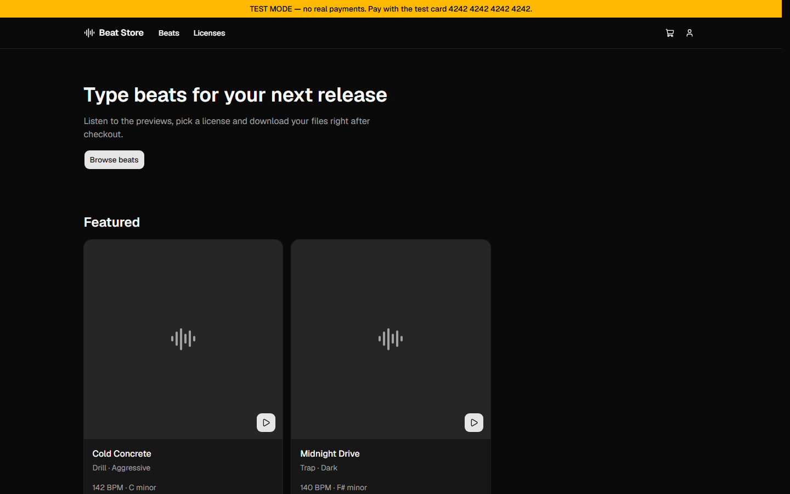
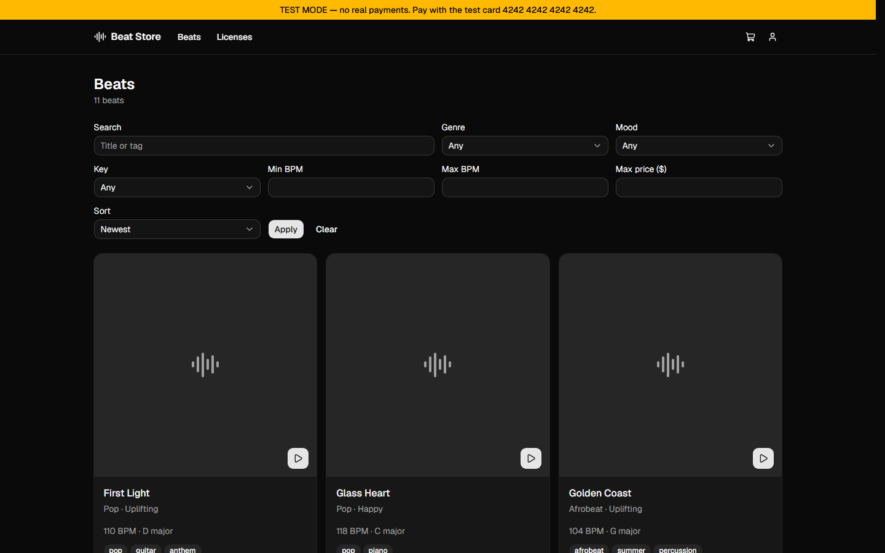
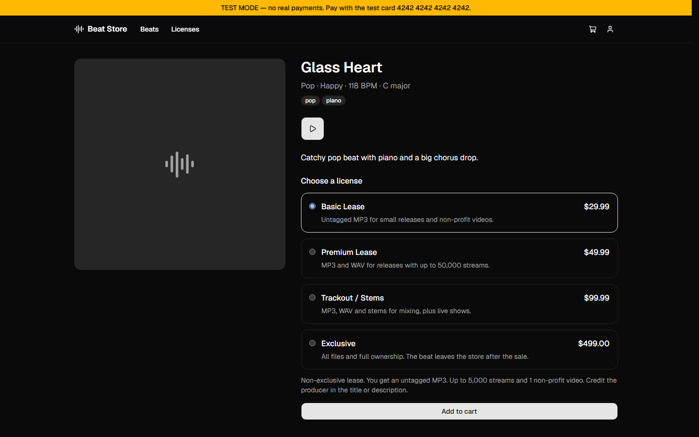
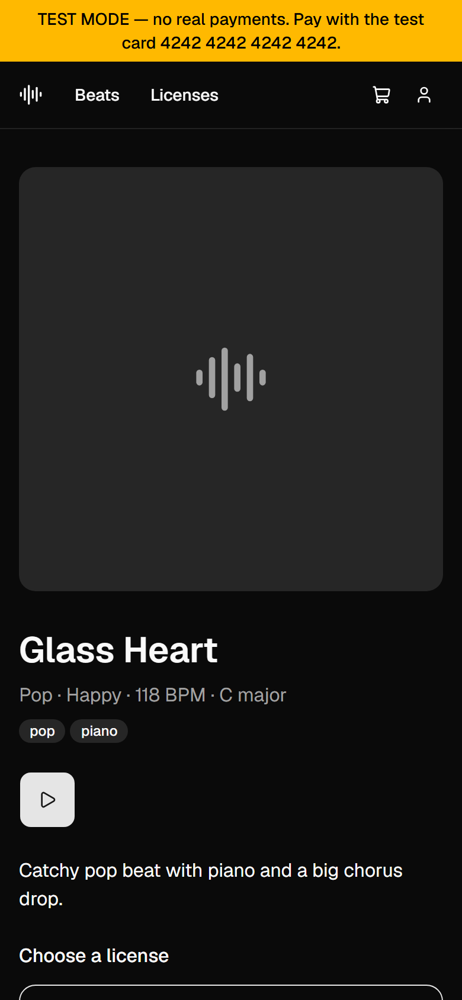
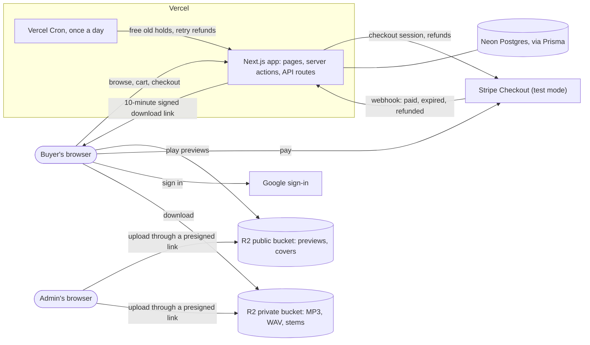

# Beat Store

Online store for type beats: a catalog with watermarked previews, four license tiers (Basic, Premium, Trackout, Exclusive), Stripe Checkout in **test mode**, signed expiring downloads and an admin panel.

**Test mode only.** No real payments: pay with Stripe's test card `4242 4242 4242 4242`.

- `PLAN.md`: features, data model, flows, folder layout and roadmap
- `PROGRESS.md`: current status, open questions and a log of every task

| Home                               | Catalog                                  |
| ---------------------------------- | ---------------------------------------- |
|  |  |

| Beat page                                         | On a phone                                                  |
| ------------------------------------------------- | ----------------------------------------------------------- |
|  |  |

## What it does

- **Catalog:** search, filters (genre, mood, key, BPM, price), sort and pages, all in the URL and done on the server. A player bar keeps playing while you browse.
- **Licenses and cart:** one tier per beat, prices in integer cents, coupons. The server re-reads every price from the database; a price sent by the browser is ignored.
- **Checkout:** Stripe Checkout. Buying an Exclusive reserves the beat with one conditional `UPDATE`, so two buyers can't both pay for it. If a second payment still slips through, it's refunded automatically.
- **Fulfilment:** the Stripe webhook checks the signature, the amount and the currency, and fulfils each order once, even when Stripe sends the same event twice or several at the same time. The success page runs the same fulfilment if the webhook is late, so it always shows the downloads.
- **Downloads:** files sit in a private bucket. Each download is a 10-minute signed link, checked against the signed-in owner or a guest link (only its SHA-256 hash is stored), and limited to 5 per file.
- **Accounts:** Google sign-in. Guest orders join an account only when Google says the email is verified.
- **Admin:** beats with direct uploads to storage (each file's size and type are checked on the server before it counts), license tiers and prices, orders and refunds, download fixes, coupons, and a dashboard.

## Stack

Next.js 16 (App Router) and TypeScript · pnpm · Tailwind and shadcn/ui · Zustand · PostgreSQL (Docker locally, Neon hosted) with Prisma · Better Auth (Google) · Cloudflare R2 (S3 API; SeaweedFS in Docker locally) · Stripe Checkout and webhooks · Zod · Vitest · ffmpeg · Vercel · GitHub Actions and Dependabot

## Architecture



The browser never gets a price, a key or a file path it can change: the server picks prices, storage keys and download links. PLAN.md §5 has every flow step by step.

## Run it locally

Needs Node 24, pnpm 12 and Docker Desktop. For payments, the [Stripe CLI](https://docs.stripe.com/stripe-cli). For demo audio, ffmpeg (`winget install Gyan.FFmpeg`).

```
pnpm install
cp .env.example .env         # PowerShell: Copy-Item .env.example .env, then fill it in
docker compose up -d         # Postgres on localhost:5433, S3 storage on localhost:8333
pnpm prisma migrate dev
pnpm db:seed                 # license tiers, the admin (ADMIN_EMAIL) and 12 demo beats
pnpm storage:setup           # buckets and CORS in the local storage
pnpm dev                     # http://localhost:3000
```

`.env.example` explains every value. Google sign-in needs an OAuth client with the redirect URI `http://localhost:3000/api/auth/callback/google`. Stripe needs test-mode keys only.

**Demo audio isn't in the repo.** Put your own beats in `audio-src/<slug>.wav` and a producer tag in `audio-src/tag.wav`, then:

```
pnpm make-preview audio-src  # tagged 128 kbps previews into public/previews/
pnpm db:seed                 # gives each demo beat with a preview its preview key
pnpm demo:upload             # previews to the public bucket, full MP3/WAV to the private one
```

To pay locally, forward Stripe's events in a second terminal:

```
stripe listen --events checkout.session.completed,checkout.session.expired,charge.refunded --forward-to localhost:3000/api/webhooks/stripe
```

## Tests and checks

```
pnpm lint && pnpm typecheck && pnpm test   # unit tests: no database, no network
pnpm test:integration                      # against the local Docker Postgres (migrated and seeded)
pnpm audit --audit-level=high
```

The integration tests cover the race conditions: 20 checkouts at once for one exclusive leave exactly 1 reservation; the same webhook sent twice, and 6 copies at once, fulfil the order once; the 6th download of a file gets 429. Stripe is never called: each test fakes the calls it needs.

CI (`.github/workflows/ci.yml`) runs the audit, lint, typecheck, unit tests and a build on every push to `develop` and every pull request to `main`. Dependabot opens update PRs weekly. Advisories that `pnpm audit` skips on purpose are listed, with the reason, in `pnpm-workspace.yaml`.

## Deploy

Vercel (the app and the cron jobs), Neon (Postgres), Cloudflare R2 (files), Stripe (test mode). Vercel deploys `main`; work happens on `develop` and reaches `main` through a pull request.

1. **Neon:** create a project in the same region as your Vercel functions (Vercel's default is Washington, D.C., `iad1`, so AWS `us-east-1`). Copy two connection strings: the **pooled** one (host contains `-pooler`) for Vercel, and the **direct** one for migrations from your PC.
2. **Cloudflare R2:**
   - Create two buckets, `beatstore-previews` and `beatstore-files`.
   - On `beatstore-previews` only, turn on the public development URL (`https://pub-….r2.dev`). That's `PUBLIC_CDN_URL`. Cloudflare rate-limits r2.dev links; a custom domain is the fix for real traffic.
   - Create two API tokens: an **Object Read & Write** token limited to the two buckets (for Vercel), and a temporary **Admin Read & Write** token (for the setup below). The endpoint is `https://<account-id>.r2.cloudflarestorage.com`.
3. **Vercel:** import the GitHub repo. The project name gives the address (`https://<name>.vercel.app`). Under Settings → Environments, set Production's branch to `main`. Set Node.js 24 and add the environment variables below, for Production. Then deploy.
4. **Set up the database and storage from your PC.** Make a file `.env.deploy` (the `.env*` pattern keeps it out of git):

   ```
   DATABASE_URL=<Neon direct connection string>
   ADMIN_EMAIL=<the Google address that should be admin>
   NODE_ENV=production
   NEXT_PUBLIC_SITE_URL=https://<name>.vercel.app
   S3_ENDPOINT=https://<account-id>.r2.cloudflarestorage.com
   S3_REGION=auto
   S3_ACCESS_KEY_ID=<admin token's key id>
   S3_SECRET_ACCESS_KEY=<admin token's secret>
   S3_PUBLIC_BUCKET=beatstore-previews
   S3_PRIVATE_BUCKET=beatstore-files
   ```

   Then, in a **new** PowerShell window (so the setting below doesn't reach your local `pnpm dev` later):

   ```
   $env:DOTENV_PATH = ".env.deploy"   # the scripts and Prisma read this file instead of .env
   pnpm prisma migrate deploy
   pnpm db:seed
   pnpm storage:setup                 # CORS: only the live site may upload (NODE_ENV=production leaves out localhost)
   pnpm demo:upload
   ```

   Close the window, delete the admin token in Cloudflare, and delete `.env.deploy` if you like. Run `pnpm prisma migrate deploy` this way again whenever a new migration ships, before the code that needs it goes live.

5. **Stripe** (dashboard, test mode): add a webhook endpoint `https://<name>.vercel.app/api/webhooks/stripe` with the events `checkout.session.completed`, `checkout.session.expired` and `charge.refunded`. Put its signing secret in Vercel as `STRIPE_WEBHOOK_SECRET` and redeploy.
6. **Google Cloud:** add the redirect URI `https://<name>.vercel.app/api/auth/callback/google` to the OAuth client. While the app is in Testing mode, only its listed test users can sign in.

Vercel environment variables (Production):

| Variable                                    | Value                                                                                 |
| ------------------------------------------- | ------------------------------------------------------------------------------------- |
| `DATABASE_URL`                              | Neon's **pooled** connection string                                                   |
| `BETTER_AUTH_SECRET`                        | a new random value (command in `.env.example`), not the local one                     |
| `BETTER_AUTH_URL`, `NEXT_PUBLIC_SITE_URL`   | `https://<name>.vercel.app`                                                           |
| `GOOGLE_CLIENT_ID`, `GOOGLE_CLIENT_SECRET`  | the OAuth client from step 6                                                          |
| `STRIPE_SECRET_KEY`                         | `sk_test_…`                                                                           |
| `STRIPE_WEBHOOK_SECRET`                     | `whsec_…` from the dashboard endpoint (step 5), not the one `stripe listen` prints    |
| `S3_ENDPOINT`, `S3_REGION`                  | `https://<account-id>.r2.cloudflarestorage.com`, `auto`                               |
| `S3_ACCESS_KEY_ID`, `S3_SECRET_ACCESS_KEY`  | the **Object Read & Write** token                                                     |
| `S3_PUBLIC_BUCKET`, `S3_PRIVATE_BUCKET`     | `beatstore-previews`, `beatstore-files`                                               |
| `PUBLIC_CDN_URL`                            | the r2.dev address, no trailing slash                                                 |
| `CRON_SECRET`                               | a random string of 16+ letters and digits; Vercel Cron sends it as `Bearer <secret>` |
| `CONTACT_EMAIL`, `INSTAGRAM_URL`, …         | optional; empty ones are left off `/contact`                                          |

`NEXT_PUBLIC_SITE_URL`, `PUBLIC_CDN_URL` and the contact values are read at build time, so changing one needs a redeploy.

**Cron jobs** (`vercel.json`): `release-reservations` frees exclusive holds whose Stripe session expired without an event, and `fulfilment-retry` retries refunds that failed. The Stripe webhooks do this work right away; the jobs are the safety net. They run once a day at about 04:00 UTC, the most Vercel's free Hobby plan allows.

**pnpm on Vercel:** Vercel picks the pnpm version from the lockfile. If the install step fails, add the environment variable `ENABLE_EXPERIMENTAL_COREPACK=1`, so Vercel uses the `packageManager` version in `package.json`.
